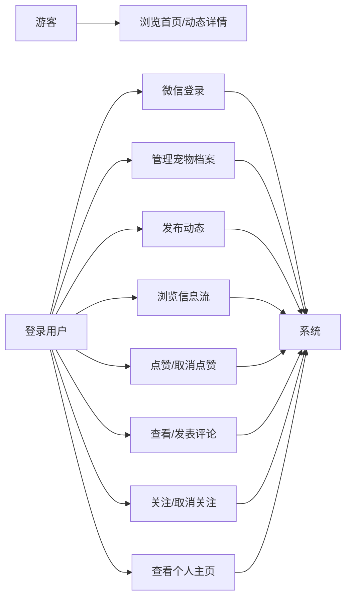
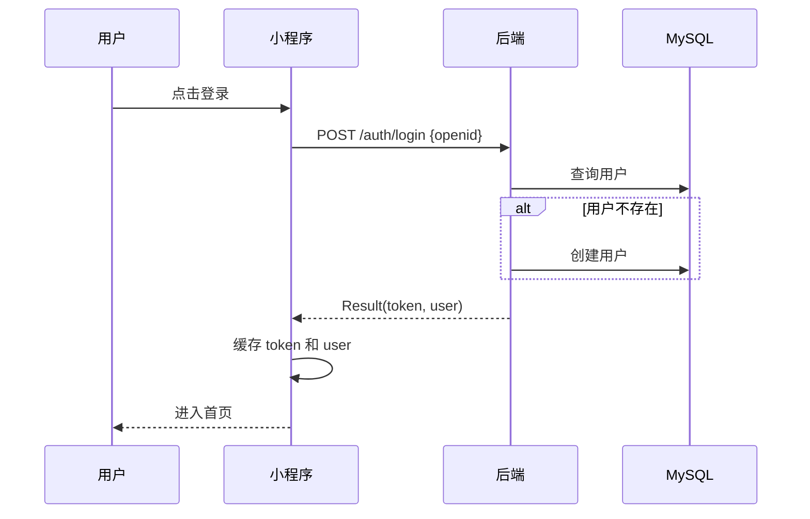
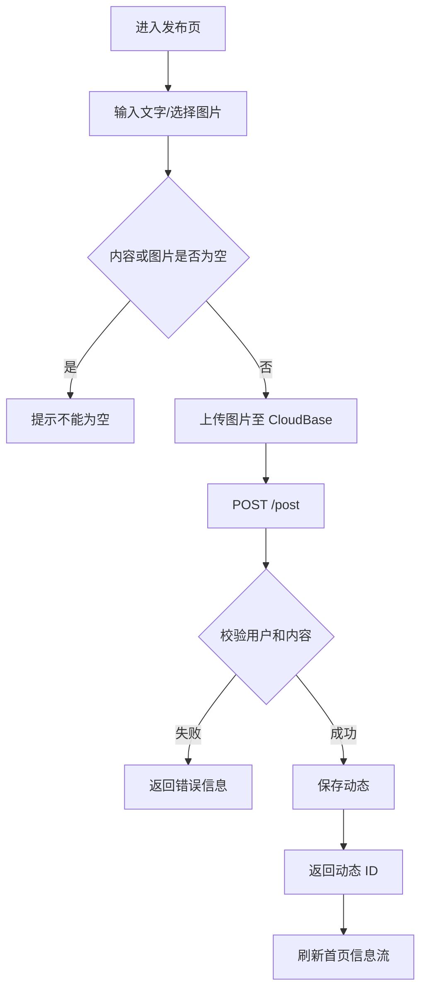

# PetTalk 需求规格说明书

## 1. 文档信息

- 项目：PetTalk 宠物社交微信小程序
- 团队：发量守恒队
- 技术栈：微信小程序原生 + Spring Boot 3.2.5 + Java 21 + MyBatis-Plus + MySQL 8
- 当前范围：登录、宠物档案、动态发布、首页信息流、点赞、评论、关注、个人主页、动态详情

## 2. 项目目标

为宠物主人提供一个记录宠物日常、分享图文动态、与其他用户互动的社交平台。用户可以维护宠物档案、发布动态、浏览信息流、点赞和评论动态，并关注感兴趣的用户。

## 3. 用户角色

| 角色 | 说明 |
| --- | --- |
| 游客 | 未登录用户，可浏览首页和动态详情，互动前需要登录 |
| 用户 | 已登录用户，可管理宠物、发布动态、点赞、评论、关注 |
| 系统 | 负责数据校验、分页、计数更新、重复操作幂等和事务处理 |

## 4. 功能需求

### 4.1 登录

- 用户通过微信授权进入小程序。
- 当前阶段后端使用模拟 `openid` 登录，返回模拟 `token` 和用户信息。
- 前端将 `token`、`user` 缓存到本地，后续请求携带 `Authorization`。

### 4.2 宠物档案

- 用户可以查看自己或其他用户的宠物列表。
- 用户可以新增、编辑、删除自己的宠物。
- 宠物字段包括昵称、品种、生日、头像。
- 宠物昵称不能为空。

### 4.3 动态发布

- 用户可以发布纯文字、纯图片或图文动态。
- 动态内容不能同时为空。
- 动态可以选择关联宠物。
- 最多上传 9 张图片，图片先上传至 CloudBase，动态中保存 `fileID`。
- 动态列表按发布时间倒序展示。

### 4.4 首页信息流

- 首页分页加载动态，默认每页 10 条。
- 支持下拉刷新和上拉加载更多。
- 动态展示内容、图片、点赞数、评论数和发布时间。

### 4.5 点赞与评论

- 用户可以点赞或取消点赞动态。
- 重复点赞、重复取消点赞必须幂等，不能重复修改计数。
- 用户可以查看动态评论并发表评论。
- 发表评论时在同一事务内更新动态评论数。

### 4.6 关注与个人主页

- 用户可以关注或取消关注其他用户，重复操作必须幂等。
- 用户不能关注自己。
- 个人主页展示用户资料、宠物、动态数、关注数、粉丝数和个人动态。
- 查看他人主页时展示关注状态和关注按钮。

### 4.7 动态详情

- 详情页展示动态内容、图片、作者、点赞数、评论数和评论列表。
- 用户可以点赞、评论、关注作者。
- 用户可以进入作者个人主页并预览动态图片。
- 当前版本暂不提供动态修改和删除接口。

## 5. 非功能需求

- 所有接口统一返回 `Result`。
- 分页接口统一使用 `page`、`size`，默认 `page=1`、`size=10`。
- 点赞、关注等重复操作必须幂等。
- 涉及计数变更的操作必须在事务中完成。
- 数据库使用 MySQL 8，字符集 `utf8mb4`。
- 后端使用 JDK 21 编译和运行。
- 接口参数校验失败时返回明确的错误信息。

## 6. 数据模型

| 表 | 说明 | 关键字段 |
| --- | --- | --- |
| `user` | 用户 | `id`、`openid`、`nickname`、`avatar`、`bio` |
| `pet` | 宠物档案 | `id`、`user_id`、`name`、`breed`、`birthday`、`avatar` |
| `post` | 动态 | `id`、`user_id`、`pet_id`、`content`、`images`、`like_count`、`comment_count` |
| `comment` | 评论 | `id`、`post_id`、`user_id`、`content` |
| `follow` | 关注关系 | `id`、`follower_id`、`followee_id` |
| `post_like` | 动态点赞 | `id`、`post_id`、`user_id` |

约束：

- `follow(follower_id, followee_id)` 唯一。
- `post_like(post_id, user_id)` 唯一。
- `post.images` 以 JSON 数组字符串存储 CloudBase `fileID`。

## 7. 用例图



## 8. 核心流程

### 8.1 登录流程



### 8.2 发布动态流程



### 8.3 点赞与评论流程

```mermaid
flowchart TD
    A[动态详情/首页] --> B{用户操作}
    B -- 点赞 --> C[POST /post/{id}/like]
    C --> D{是否已点赞}
    D -- 是 --> E[保持幂等，不重复计数]
    D -- 否 --> F[新增点赞记录并 like_count + 1]
    B -- 评论 --> G[POST /comment]
    G --> H{评论内容是否为空}
    H -- 是 --> I[返回错误]
    H -- 否 --> J[保存评论并在事务中 comment_count + 1]
```

### 8.4 关注与个人主页流程

```mermaid
flowchart TD
    A[进入个人主页] --> B[GET /user/{userId}/profile]
    B --> C[返回用户、宠物、统计和个人动态]
    C --> D{是否查看自己}
    D -- 是 --> E[展示宠物编辑和发布入口]
    D -- 否 --> F[展示关注按钮]
    F --> G[POST /follow 或 DELETE /follow]
    G --> H[刷新关注状态和粉丝数]
```

## 9. 验收标准

- 登录成功后 `token` 和用户信息写入本地缓存。
- 宠物档案可以新增、编辑、删除并在个人主页展示。
- 动态发布成功后首页和作者主页可以看到新动态。
- 首页支持分页、下拉刷新和上拉加载。
- 重复点赞、重复关注不会重复增加计数。
- 评论发布后评论数同步增加，评论列表可以看到新评论。
- 动态详情页可以点赞、评论、关注作者并进入作者主页。
- 后端使用 JDK 21 编译通过。

## 10. 本期不包含

- 真实微信 `code2session` 登录和 JWT 正式鉴权。
- 关注/粉丝列表页面。
- 动态编辑、动态删除和举报。
